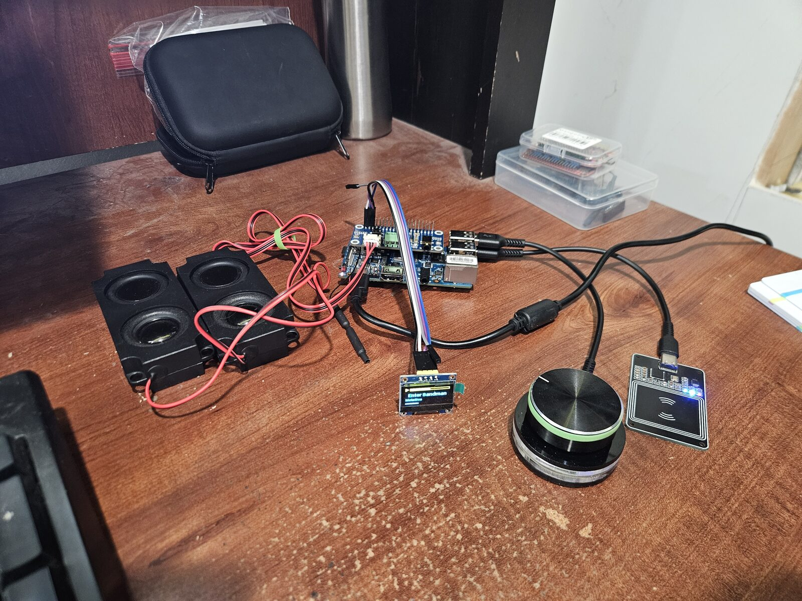

# phoniebox-nix

NixOS packaging of [Phoniebox](https://github.com/MiczFlor/RPi-Jukebox-RFID) (RPi-Jukebox-RFID
v3) — the RFID jukebox where you tap a card and music plays.

This is a flake providing the daemon, the web app, a NixOS module (`services.phoniebox`), and a
set of patches against a pinned upstream commit. Everything is declarative: your jukebox is a
NixOS config, and `nixos-rebuild` is the whole install-and-upgrade story. However, I haven't
supported the whole installer yet, so not all configurations will port over — see
[what this does *not* cover](#what-this-does-not-cover).



## Why

Upstream Phoniebox installs itself with a shell script that mutates a Raspberry Pi OS image.
That works, but it isn't reproducible, it's awkward to roll back, and it assumes a Pi. Packaging
it for NixOS means the whole jukebox — daemon, MPD, web server, reader config, audio routing,
display — is one config file, rebuilt atomically and rolled back by picking an older generation.

It also makes non-Pi hardware practical. The jukebox this was developed on is an **Orange Pi RV
(RISC-V)**; it has also run on an Orange Pi Zero 3 (aarch64). Nothing here is Pi-specific.

## What's in the box

| Path | What it is |
|---|---|
| `pkgs/phoniebox` | The jukebox daemon |
| `pkgs/phoniebox-webapp` | The React web app, built from source |
| `pkgs/phoniebox-display` | Small OLED status service (track, artist, volume) |
| `pkgs/py532lib`, `pkgs/luma-oled` | Python deps not in nixpkgs |
| `modules/phoniebox.nix` | The `services.phoniebox` NixOS module |
| `patches/` | Fixes and features applied to the pinned upstream source |

## Quick start

Add the flake as an input and enable the module:

```nix
{
  inputs.phoniebox.url = "github:PNG-pyro/phoniebox-nix";

  # in your NixOS config:
  imports = [ inputs.phoniebox.nixosModules.default ];

  services.phoniebox = {
    enable = true;
    user = "yourname";          # services run as this (lingering) user
    openFirewall = true;

    readers.read_00 = {
      module = "generic_nfcpy";
      settings.device_path = "tty:USB0:pn532";
    };

    audio.primary = {
      sink = "alsa_output.platform-sound.stereo-fallback";
      alias = "Speakers";
    };
  };
}
```

Then browse to the box on port 80. Music, cards and playlists live under
`/var/lib/phoniebox/shared/`, which survives rebuilds and rollbacks.

## Module options worth knowing

| Option | Does |
|---|---|
| `readers.<name>` | RFID readers; `generic_nfcpy`, `generic_usb`, `rdm6300_serial`, `pn532_i2c_py532` |
| `audio.primary` / `.secondary` | Named outputs (e.g. speakers / headphones) with optional per-output volume ceilings |
| `audio.normalize` | Even out loudness between tracks |
| `login.enable` | HTTP basic auth in front of the web app; set the password on the box with `sudo phoniebox-set-password` (see caveat below) |
| `copyparty.enable` | Web uploads for the music folder, served at `/upload` |
| `tls.enable` | HTTPS alongside HTTP — see note below |
| `display.enable` | I2C OLED status display |
| `hotspot.enable` | Fall back to a setup hotspot with captive portal when no known WiFi is around |
| `settings` | Arbitrary `jukebox.yaml` keys, deep-merged on every start |
| `extraFeatures.enable` | Turn off everything in the next section (default: on) |

### `login.enable`

This is implemented entirely in the NixOS module — Caddy `basic_auth` plus a
`phoniebox-set-password` helper — so it doesn't depend on any of the patches. Until you set a
password, no login is asked for.

Caveat: it was built and used against the `main` branch and **hasn't been exercised on
`develop`**. The auth covers `/api/`, which on this branch is also where the web app opens its
event WebSocket, and that combination is untested here. If you turn it on and the UI stops
receiving updates, that's the first place to look.

### `tls.enable`

Mainly useful for uploads: browsers only expose `crypto.subtle` in a secure context, so over
plain HTTP copyparty's uploader falls back to hashing in WebAssembly instead of the browser's
native SHA-512 — noticeably slower for large files.

**Set `tls.hostNames` explicitly.** It defaults to the machine's FQDN, which on a host without
`networking.domain` is a dotless hostname. If clients reach the box as `jukebox.lan` (a search
domain handed out by your router, which NixOS knows nothing about), the certificate won't match
and the handshake fails with a confusing internal-error alert rather than a trust warning:

```nix
services.phoniebox.tls = {
  enable = true;
  hostNames = [ "jukebox.lan" "jukebox" ];
};
```

Without `certFile`/`keyFile` Caddy issues its own certificate, which browsers distrust until
you install its root CA. Clicking through the warning is enough for the upload speedup; the
install is only to silence it. HTTP is deliberately left serving everything and is not
redirected, because the captive portal has to stay plaintext.

## Changes on top of upstream

Everything beyond upstream lives in `patches/` and is applied to a pinned commit. Set
`services.phoniebox.extraFeatures.enable = false` to get a close-to-upstream build — hardware
fixes (such as the PN532 reader patch) always apply regardless.

- **Playlists, Podcasts and Radio** as first-class library views, with create/delete dialogs.
  Podcast and radio folders are created with their feed or stream URL up front.
- **Add music to a playlist** from the library picker — songs, folders or whole albums, which
  are expanded into their tracks and appended to the playlist's `.m3u`. Duplicates are skipped,
  and if that playlist is currently playing, the additions join the live queue.
- **Readable metadata in collection views** — tracks show title/artist/duration from MPD's tags
  instead of a bare filename, and podcast episodes use the title from the feed instead of the
  raw enclosure URL.
- **Friendly card names.** Cards carry an editable label, pre-filled from whatever the card
  plays (album name, folder name, or the track's title).
- **Uploads via copyparty** rather than the built-in uploader: the library's Upload button
  deep-links into the folder you're browsing, and an upload hook tells the daemon to rescan once
  the upload settles.
- Web app quality-of-life: lazy-loaded cover art, remembered scroll position, a floating back
  bar, and a responsive header that survives a phone-sized screen.
- PN532 reader fixes for USB serial adapters.

## What this does *not* cover

This packages the parts needed to run the jukebox; it is not a reimplementation of upstream's
installer. Things upstream's `install-jukebox.sh` can set up that have no equivalent here:

- **Kiosk mode** — upstream's `setup_kiosk_mode.sh` (a local browser showing the web app on an
  attached screen). No declarative option for it yet.
- **Samba share** — upstream's `setup_samba.sh`. `copyparty.enable` covers a similar need over
  HTTP, but it isn't the same thing.
- **Bluetooth audio.**
- **HiFiBerry and other board-specific audio helpers** — `audio.primary`/`.secondary` just take
  PipeWire sink names, so anything PipeWire can see works, but there's no per-HAT setup helper.
- Raspberry-Pi-specific steps (`raspi-config`, boot-time tuning, OS updates) — not applicable
  on NixOS.

More generally: the options here are the ones this build needed. Plenty of upstream settings
have simply never been looked at, and can be reached through `services.phoniebox.settings`,
which writes arbitrary keys into `jukebox.yaml`. Patches welcome if you wire one up properly.

## Hardware notes

Collected while getting this running on an Orange Pi RV; may save someone else the afternoon.

- **Check what the device tree claims about RAM.** The mainline `jh7110-orangepi-rv.dtb`
  hardcodes 4 GiB for every variant. On a 2 GB board where NixOS supplies its own DTB (so
  U-Boot's `/memory` fixup never reaches the kernel), Linux happily allocates into 2 GB of
  address space that doesn't exist — which presents as random hard freezes with nothing in the
  journal, plus ext4 corruption that survives re-flashing the card, because the page cache is
  already corrupt before writeback. `U-Boot SPL` prints the real size (`LPDDR4: 2G`) on the
  serial console. A small overlay correcting the `memory@40000000` node fixes it.
- **A frozen board writes no logs.** The journal is persistent, but a hard hang never gets
  flushed, so the log simply stops mid-sentence. If you're chasing lockups, wire up the UART and
  set `kernel.sysrq = 1` so you can dump stuck tasks over serial while it's wedged.
- `systemd-fsck` no longer honours `/forcefsck`. Use the `fsck.mode=force fsck.repair=yes`
  kernel parameters, or check the card offline.

## Status

Works, and runs a real jukebox daily. The `develop` branch tracks upstream `future3/develop`;
`main` tracks the older `future3/main` and is what the first build ran on. Patches are pinned to
a specific upstream commit, so bumping that commit means regenerating them — not a one-line
change.

Issues and patches welcome, especially from anyone running this on other hardware.

## License

MIT, same as upstream Phoniebox — see [LICENSE](LICENSE). The files in `patches/` are
derivative of [RPi-Jukebox-RFID](https://github.com/MiczFlor/RPi-Jukebox-RFID), which is also
MIT.
